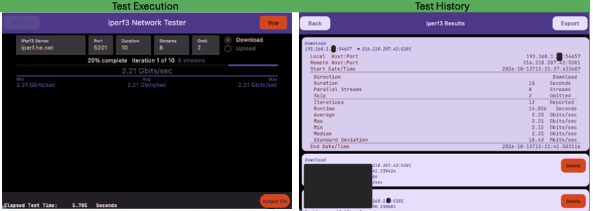

<h1 align="center">Network Testing (iperf3) GUI and CLI</h1>

iperf3KMP is a cross-platform network performance testing app for Android, iOS, and desktop (macOS, Windows, Linux), built from a single Kotlin Multiplatform codebase with a shared Compose UI.

**Highlights:**
- **Real iperf3, not a simulation** — runs an embedded iperf3 3.21 client in-process (JNI on Android/desktop, Kotlin/Native cinterop on iOS) against the same shared C core on every platform.
- **Genuine measurements** — real TCP/UDP throughput, jitter, and loss, not canned or mocked output.
- **Built-in history** — results are saved locally via Room/SQLite, with a history view and CSV export.
- **GUI and CLI** — the desktop build ships both a Compose GUI and a standalone CLI tool.
- **Native installers** — `.dmg`, `.msi`, `.deb`, and `.rpm` packages for each desktop OS.

## Platforms Supported
1. Android<br>
    * `arm64` <ins>physical</ins> and <ins>simulator</ins><br>
    * `x86_64` <ins>simulator only</ins><br>
2. iOS<br>
   * `arm64` <ins>physical</ins> and <ins>simulator</ins><br>
   * `x86_64` <ins>simulator <ins>is not supported</ins><br>
4. Desktop `GUI` (JVM — `macOS` / `Linux `/ `Windows`)<br>
	* macOS – `aarch64` (`M series only`; **no** `x86_64`)<br>
	* Linux – `x86_64`<br>
      * _rpm_ - <ins>Fedora/RHEL</ins><br>
      * _deb_ - <ins>Debian/Ubuntu</ins><br>
    * Linux – `arm64`<br>
        * _rpm_ - <ins>Fedora/RHEL</ins><br>
        * _deb_ - <ins>Debian/Ubuntu</ins><br>
    * Windows<br>
        * `x86_64`<br>
        * `arm64` (partially _x86_64_ via Prism translation)<br>
4. Desktop `CLI` (`macOS` / `Linux `/ `Windows`)
    * _Same platforms as `GUI`_<br>




---

# Installation


> [!NOTE]
> ### Install using a single command<br>
>> #### `Linux` / `macOS`
>> ```shell
>> curl -s https://github.com/jerryabramson/iperf3-kmp/install.sh | bash -s
>> ```
> #### `Windows`
>> ```shell
>>  Invoke-WebRequest -URI "https://github.com/jerryabramson/iperf3-kmp/install.ps1" -OutFile install.ps1
>> .\install.ps1 
>> ```
>> 

---

### `Platform Installers`
# Initial Installers

| Installer                                                                                                                        | Operating System       | architecture |
|----------------------------------------------------------------------------------------------------------------------------------|------------------------|--------------|
| [androidApp-debug.apk](https://github.com/jerryabramson/iperf3-kmp/releases/download/0.1/androidApp-debug.apk)                   | Android                | `arm`        |
| [iperf3KMP.ipa](https://github.com/jerryabramson/iperf3-kmp/releases/download/0.1/iperf3KMP.ipa)                                 | iOS (debug image)      | `aarch64`    |
| [iperf3KMP-1.0.0.dmg](https://github.com/jerryabramson/iperf3-kmp/releases/download/0.1/iperf3KMP-1.0.0.dmg)                     | macOS                  | `aarch64`    |
| [iperf3kmp_1.0.0_arm64.deb](https://github.com/jerryabramson/iperf3-kmp/releases/download/0.1/iperf3kmp_1.0.0_arm64.deb)         | Debian/Ubuntu          | `arm64`      |
| [iperf3kmp-1.0.0-1.aarch64.rpm](https://github.com/jerryabramson/iperf3-kmp/releases/download/0.1/iperf3kmp-1.0.0-1.aarch64.rpm) | Fedora/RHEL            | `aarch64`    |
| iperf3KMP-1.0.0_arm64.msi                                                                                                        | **TBD** Windows on ARM | `arm64`      |


| Installer                                                                                                                      | Operating System | architecture |
|--------------------------------------------------------------------------------------------------------------------------------|------------------|--------------|
| [iperf3KMP-1.0.0.msi](https://github.com/jerryabramson/iperf3-kmp/releases/download/0.1/iperf3KMP-1.0.0.msi)                   | Windows          | `x86_64`     |
| [iperf3kmp_1.0.0_amd64.deb](https://github.com/jerryabramson/iperf3-kmp/releases/download/0.1/iperf3kmp_1.0.0_amd64.deb)       | Debian/Ubuntu    | `x86_64`     |
| [iperf3kmp-1.0.0-1.x86_64.rpm](https://github.com/jerryabramson/iperf3-kmp/releases/download/0.1/iperf3kmp-1.0.0-1.x86_64.rpm) | Fedora/RHEL      | `x86_64`     |


 ### `Source Code`

| artifact        | Format   |
|-----------------|----------|
| * [zip](...)    | zipfile  |
| * [tar.gz](...) | tarfile  |


---

> [!TIP]
>### When building from source code, there are three options to download: 
>1. Clone and build to a running app on the current *platform/architecture*:
>>```shell
>>git clone https://github.com/jerryabramson/iperf3-kmp --recursive
>>cd iperf3-kmp/
>>```
>2. **The full `esnet/iperf` source tree isn't included in this repo** 
>>  * it's a git submodule pinned to the `3.21` tag, which is required for every target:
>>    * `Android` `iOS` and `Desktop` all link against it<br>
>><br>    
>>  * After cloning, if the `thirdparty/iperf` subdirectory is empty:
>>```shell
>>git submodule update --init --recursive
>>```
>3. If the source code is downloaded as a zipfile or tar.gz
>>```shell
>>cd third_party
>>rmdir iperf
>>git clone https://github.com/esnet/iperf.git
>>```
> * **Run desktop app (Linux, macOS, or Windows — on Windows use `gradlew.bat`, see the Windows section below)**
>> ```shell
>> ./gradlew :desktopApp:run
>> ```

---

# Code Layout
* [/iosApp](./iosApp/iosApp) contains an iOS application.
  - Even if you’re sharing your UI with Compose Multiplatform, you need this entry point for your iOS app.
  - This is also where you should add SwiftUI code for your project.
<br>  
* [/shared](./shared/src) is for code that will be shared across your Compose Multiplatform applications.
  - subfolders
    - [commonMain](./shared/src/commonMain/kotlin) is for code that’s common for all targets.
<br>  
       - Sub-folders are for Kotlin code that will be compiled for only the platform indicated in the folder name.  
           - [androidMain](./shared/src/androidMain/kotlin) Android specific code.
           - [jvmMain](./shared/src/jvmMain/kotlin) Desktop (JVM) specific code.
           - [iosMain](./shared/src/iosMain/kotlin) iOS versions (Kotlin code).
              - *For example, if you want to use Apple’s CoreCrypto for the iOS part of your Kotlin app, this folder would be the right place for such calls.*

# Building and running recipes, per platform

## Build using IDE
> [!TIP]
> Use the run configurations provided by the run widget in your IDE's toolbar


## Build from the command-line
> [!WARNING]
> Gradle `command-line` syntax and options
> * Short per-platform build checklists (_prerequisites_, _commands_, _gotchas_) are in [PLATFORM_BUILD_NOTES.md](./PLATFORM_BUILD_NOTES.md).
### Android
Needs the Android SDK (`sdk.dir` in `local.properties`, or `ANDROID_HOME`). To build only:
```shell
./gradlew :androidApp:assembleDebug
```
To also boot an emulator and run the app on it, entirely from the command line.
* To see the available AVDs:
```
$ANDROID_HOME/emulator/emulator -list-avds
```
* swap `Pixel_8` for one of your own)
```shell
$ANDROID_HOME/emulator/emulator -avd Pixel_8 &                     # boots with a visible window
$ANDROID_HOME/platform-tools/adb wait-for-device
until [ "$($ANDROID_HOME/platform-tools/adb shell getprop sys.boot_completed | tr -d '\r')" = "1" ]; do sleep 2; done
./gradlew :androidApp:installDebug                                  # builds + installs to the running emulator
$ANDROID_HOME/platform-tools/adb shell am start \
  -n com.jabramson.iperf3_network_tester_kmp/.MainActivity
```

---

### iOS

 * macOS + Xcode only — build/run is managed by Xcode's own tooling, not Gradle.
 * Gradle's Kotlin Multiplatform plugin only builds the shared
 Kotlin framework, not the final signed `.app`). 
 * Easiest is opening [iosApp/iosApp.xcodeproj](./iosApp/iosApp.xcodeproj) in Xcode and
 running from there
   * The application can also be built and launched on a Simulator entirely from the command line.
   * no Xcode UI required.<br>
>[!WARNING]
>   * If the following error is displayed at build time, you need to open the application using Xcode, login to Apple developer, and enter the required `BundleID` 
>```shell
>>Task :shared:linkDebugFrameworkIosArm64
>warning: Cannot infer a bundle ID from packages of source files and exported dependencies, use the bundle name instead: Shared. Please specify the bundle ID explicitly using the -Xbinary=bundleId=<id> compiler flag.
>Cannot infer a bundle ID from packages of source files and exported dependencies, use the bundle name instead: Shared. Please specify the bundle ID explicitly using the -Xbinary=bundleId=<id> compiler flag.
>```

#### Build from command-line on macOS
```shell
# opens the Simulator window first, so it's visible throughout
open -a Simulator

# skip if a simulator is already booted
xcrun simctl boot "iPhone 17"

# Build and install
xcodebuild -project iosApp/iosApp.xcodeproj -scheme iosApp -sdk iphonesimulator -configuration Debug \
  -derivedDataPath build/ios build
xcrun simctl install booted build/ios/Build/Products/Debug-iphonesimulator/iperf3KMP.app
xcrun simctl launch booted com.jabramson.iperf3-network-tester-kmp
```
>[!TIP]
>`simctl boot` alone starts the device headlessly with no visible window — `open -a Simulator` first is what actually
puts it on screen.

---

### Desktop — `macOS` / `Linux`
Requires a `clang` on `PATH` in order to compile the native iperf3/printf-formatting JNI bridges at build time; see `CLAUDE.md`'s "Native iperf3 client" section):
```shell
 # Normal build/run
 gradlew :desktopApp:run
 ```
```shell
 # hot reload during development
 gradlew :desktopApp:hotRun --auto   
```

---

#### Desktop — `Windows`
* _Windows_ is now supported. 
  - However, it has numerous special requirements and limitations
    * Architectural Difference: Does not reuse the in-process JNI path the other desktop
targets use
    * instead, a bundled, Gradle-built-from-source `iperf3.exe` runs as a real
subprocess (`ProcessBuilder`).
* Special Requirements:
  * [Cygwin](https://cygwin.com/) installed at `C:\cygwin64` with the `gcc-core` and `make`
  packages 
    * This builds the `iperf3.exe` executable itself (Cygwin's own `gcc`, not `clang`;
      * Cygwin's bundled `clang` can't build against Cygwin's own newer headers.
  * A native Windows _LLVM_ `clang` (e.g. `winget install LLVM.LLVM`) 
    * builds the JNI printf-formatting helper, same as macOS/Linux above.
      * On Windows, `clang` takes its C headers and libraries from Visual Studio, so also install the [Visual Studio Build Tools](https://visualstudio.microsoft.com/downloads/) with the
"_Desktop development with C++_" **workload** (add the ARM64 build tools on a Windows-on-Arm
  machine). 
      * Without it the build fails with `'stdio.h' file not found`.
  * The [WiX Toolset](https://wixtoolset.org/) — required by `jpackage` to emit the `.msi`.
```shell
gradlew.bat :desktopApp:run
gradlew.bat :desktopApp:packageMsi
```
#### See [WINDOWS_DECISION_REVERSAL_CASE_STUDY.md](docs/desktop/WINDOWS_DECISION_REVERSAL_CASE_STUDY.md)
For the full story of why this was originally rejected and what changed. An MSI built on a Windows ARM64 machine has a native ARM64 JVM (built and installed on a
Parallels VM); the x64 MSI also runs there under Prism. Only `iperf3.exe` is x86_64 in both
(Cygwin has no ARM64 port); a native ARM64 `iperf3.exe` is planned but not started — see [WINDOWS_ARM64_IPERF3_PLAN.md](docs/desktop/WINDOWS_ARM64_IPERF3_PLAN.md).

---

#### Desktop — command-line mode (without a GUI)
* Pass any arguments and the desktop app runs a real iperf3 test from the terminal instead of opening
the GUI — the exact same engine (real libiperf, live output parsing, stall detection), just rendered
with ANSI escape codes instead of Compose widgets. 
* The packaged launcher (`iperf3KMP`/`iperf3KMP.bat` / `iperf3KMP.ps1`)
serves both uses; with Gradle, pass args via `--args`:

* Once the app is installed from a package (`.deb`/`.rpm`/`.dmg`/`.msi`):
  * [`bin/iperf3kmp`](bin/iperf3kmp) (macOS/Linux) 
  * [`bin/iperf3kmp.ps1`](bin/iperf3kmp.ps1)/[`bin/iperf3kmp.bat`](bin/iperf3kmp.bat) (Windows)
* finds the installed launcher at its OS-specific location and run it, so you don't need to know jpackage's
per-platform install layout:
```shell
# macOS/Linux
./bin/iperf3kmp my-iperf3-server.example.com -t 10 -P 4

# Windows Powershell
.\bin\iperf3kmp.ps1 my-iperf3-server.example.com -t 10 -P 4
 
# Windows BAT
.\bin\iperf3kmp.bat my-iperf3-server.example.com -t 10 -P 4 
```

>#### Example Execution
>

1. ANSI output works out of the box on Windows too.
2. Falls back to plain text (no escape codes) elsewhere when `TERM` looks like a dumb terminal, so redirected-to-a-file and CI/log-capture  output stays readable. 
   * See `desktopApp/.../cli/CliArgs.kt`'s `usage()` for the full flag list
3. When checking how the live output actually looks (cursor positioning, in-place redraws, column
alignment), test via the packaged binary (`bin/iperf3kmp`/`iperf3KMP.exe` or the built app directly)
4. Do not use `./gradlew :desktopApp:run` 
>* even with  `--args`/ `--console=plain` 
>  * **Gradle** wraps the forked JVM's stdout, so it isn't a real TTY from the process's own perspective
>  * _Buffering_, `isatty()` detection, and _terminal-width queries_ can all behave differently than a genuine terminal).<br> 
>  * This affects exactly what this mode requires: 
>      * Absolute cursor positioning and live in-place redraws. 

---

# Desktop packaging
| Platform                                                                                                                   | task                               |
|----------------------------------------------------------------------------------------------------------------------------|------------------------------------|
| macOS                                                                                                                      | ./gradlew :desktopApp:packageDmg   |
| Debian/Ubuntu Linux x86_64                                                                                                 | ./gradlew :desktopApp:packageDeb   |
| Fedora/Red Hat Linux x86_64 *                                                                                              | ./gradlew :desktopApp:packageRpm   |
| Fedora/Red Hat aarch64 *                                                                                                   | ./gradlew :desktopApp:packageRpm   |
| Debian/Ubuntu Linux x86_64 or aarch64 - on a non-Debian host (Fedora/RHEL, or macOS with Docker Desktop)                   | packageDebianFromContainer.sh      |
| Fedora/RHEL x86_64 or aarch64 - on a non-RPM host (Debian/Ubuntu, or macOS with Docker Desktop)                            | packageRpmFromContainer.sh         |
| Windows x86_64                                                                                                             | gradlew.bat :desktopApp:packageMsi |
| Windows ARM64 (native ARM64 JVM; bundled `iperf3.exe` is x86_64 under Prism emulation — see WINDOWS_ARM64_IPERF3_PLAN.md)  | gradlew.bat :desktopApp:packageMsi |


>[!TIP]
>> _Both container-based scripts auto-detect Podman or Docker (whichever is on `PATH`) and build a native, non-emulated Linux container matching the host's CPU - including on Apple Silicon or Intel Macs via Docker Desktop, since it runs a real Linux VM matching the host architecture. Verified via Podman on Fedora x86_64 and Fedora aarch64, and via Docker Desktop on macOS (Apple Silicon) producing both `iperf3kmp_1.0.0_arm64.deb` and `iperf3kmp-1.0.0-1.aarch64.rpm`._

>[!CAUTION]
>>See Gotcha's in `CLAUDE.md`


>[!TIP]
>> * Note: the `third_party/iperf` submodule points at the public [`esnet/iperf`](https://github.com/esnet/iperf) project<br> 
>> * Therefore, no authentication is required after cloning:
>>   * Run `git submodule update --init --recursive` 

